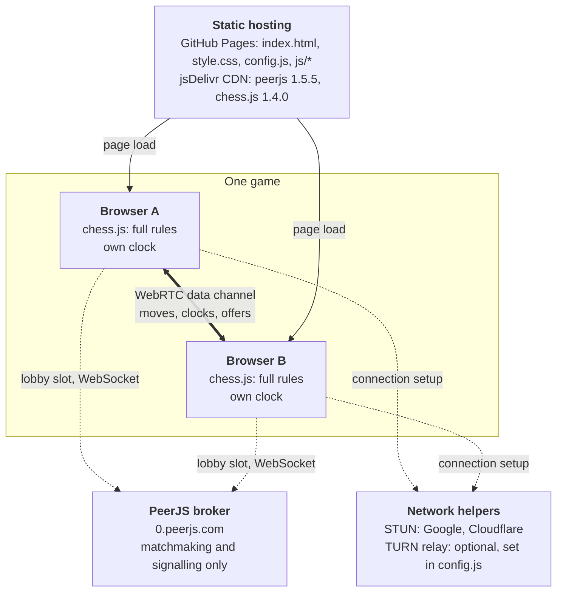
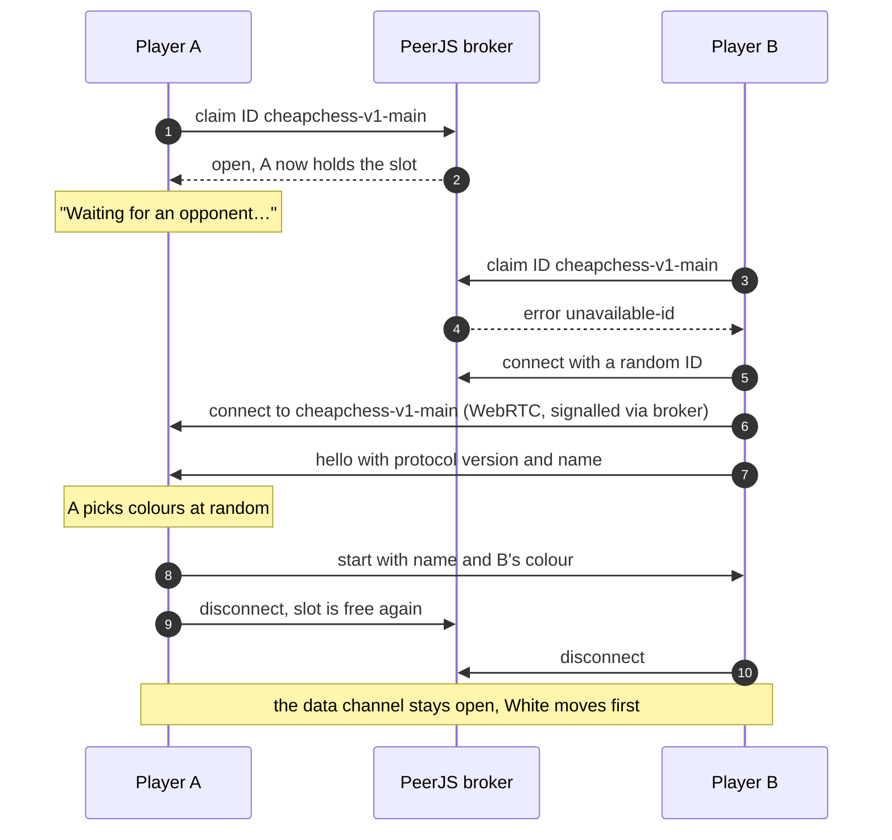
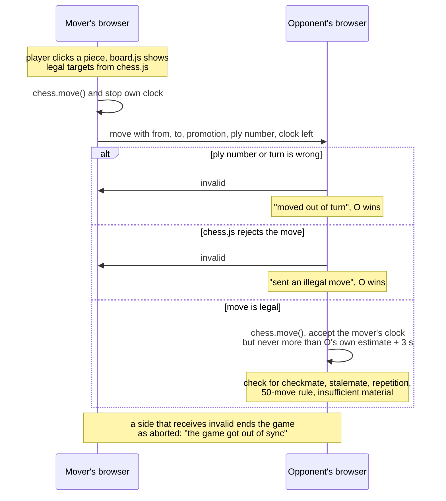
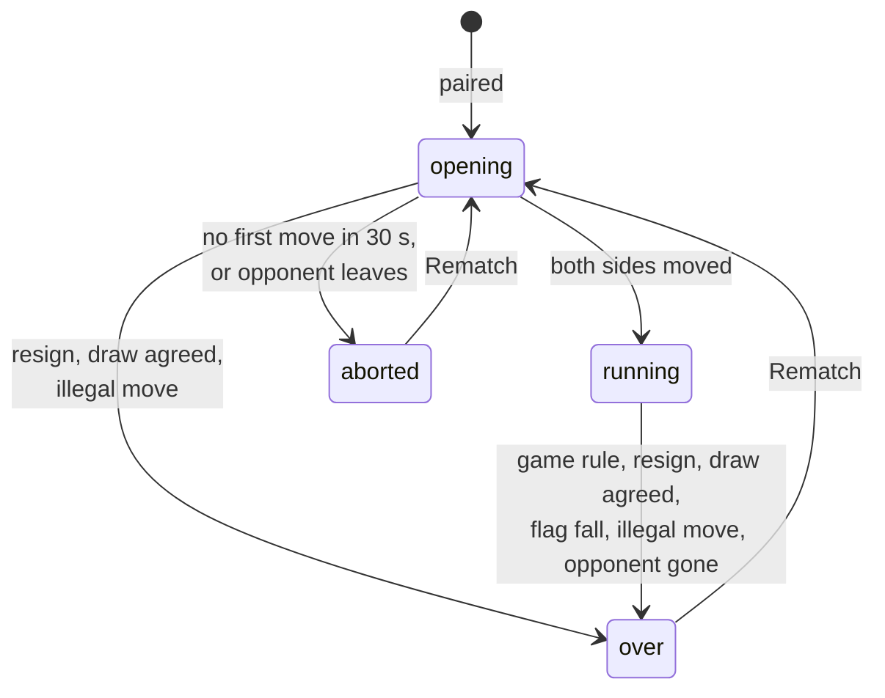
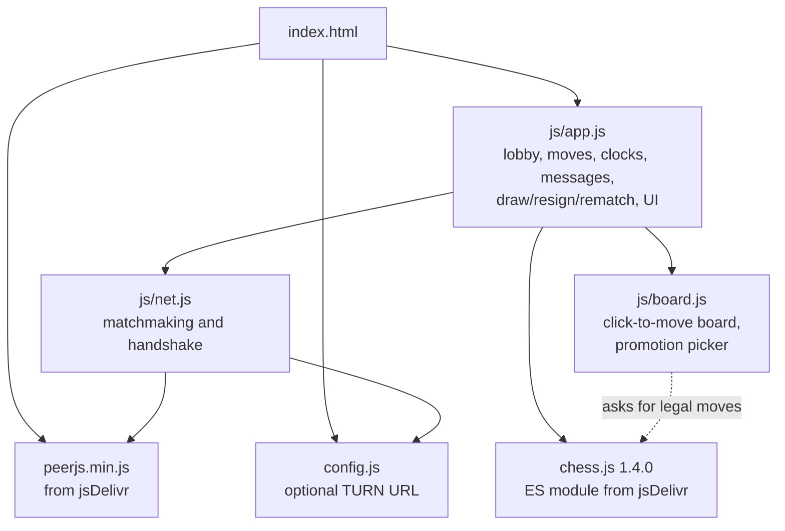

# CheapChess architecture

CheapChess is a static website. There is no game server: GitHub Pages serves the files, a
free public broker introduces the two players, and from then on the two browsers talk
directly to each other over WebRTC. Unlike a server-refereed game, **both** browsers run
the full chess rules and check every move the other one sends.

## 1. System overview

Dotted lines are only used while connecting. Once the data channel is open, both players
leave the broker, so the broker never sees a move and the lobby slot is free for the next
pair. STUN lets each browser find its public address so they can connect directly. If a
network blocks that (strict NATs, many mobile carriers, offices), the traffic has to go
through a TURN relay; with none configured, those players can't play each other.

## 2. Matchmaking: the lobby slot

Everyone tries to claim the same peer ID, `cheapchess-v1-main` (or `cheapchess-v1-<name>`
with `?lobby=<name>`). The broker gives an ID to only one client at a time, so the first
player to arrive waits in the slot and the next one connects to them. The slot holder
picks the colours at random.

Failure handling in `js/net.js`:

| Situation | What happens |
| --- | --- |
| Slot holder is already mid-handshake with someone else | It answers `busy` and the newcomer retries |
| Slot holder left before the guest connected (`peer-unavailable`) | The guest tries to take the slot itself |
| Handshake doesn't finish within 10 s | Counted as a failed connection; after 2 the status warns that the network may block direct play |
| A host has 2 guests fail in a row | It gives up the slot for 10–15 s so a reachable player can host |
| More than 15 broker errors | Search stops with "Could not reach the matchmaking service" |
| Protocol version mismatch | The host answers `busy`, so old and new versions never pair |

## 3. Playing a move

There is no referee, so each side plays its own move into its own chess.js board and sends
it; the receiver replays it on its board and rejects anything that doesn't fit. Each move
also carries the mover's clock reading.

Both sides apply the same checks after every move, so they reach the same result without
needing to tell each other who won. The messages that do end a game by themselves are
listed below.

| Message | Sent when | Receiver |
| --- | --- | --- |
| `resign` | Player confirms Resign (two clicks) | Wins |
| `draw-offer` | Player offers a draw on their own move, at most once per move | Shows Accept / Decline; moving also declines |
| `draw-accept` / `draw-decline` | Opponent answered the offer | Game drawn / offer cleared |
| `timeout` | A side's clock reached zero | Only believed if its own clock agrees, within the 3 s lag allowance |
| `abort` | Someone didn't make a first move within 30 s | Game aborted, no result |
| `rematch` | Player clicked Rematch after the game | New game starts when both have asked, colours swapped |
| `invalid` | The other side's move didn't check out | Game aborted as out of sync, connection closed |
| `ping` | Every 4 s | No reply needed: any message counts as "still here"; 20 s of silence means the opponent is gone |

### Clocks

Each player has 10 minutes. Neither clock runs until both sides have made their first move;
until then each side has 30 seconds to move or the game is aborted. Each browser keeps both
clocks itself. When a move arrives, the receiver takes the mover's reported time but caps
it at its own estimate plus a 3-second lag allowance, so a modified client can gain at most
that much per move. When a clock runs out, the side that notices sends `timeout`; the other
side only accepts it if its own view of the clock agrees.

## 4. Game states

In **opening** the clocks are frozen and each side has 30 seconds to make a first move. In
**running** the mover's clock ticks. "Game rule" means checkmate, stalemate, threefold
repetition, the 50-move rule or insufficient material. If the opponent leaves before both
first moves are made, the game counts as aborted rather than a win.

Rematch needs both players to click it and swaps the colours. It is only possible while the
connection is still open, so not after a game that ended with `invalid` (that closes the
connection) or after the opponent left. From **over** or **aborted** either player can also
click New opponent, which closes this connection and goes back to matchmaking.

## 5. Code layout

`js/board.js` only draws the position and turns clicks into moves; it asks chess.js for
the legal targets so it never offers an illegal move. All game logic, timing and
networking lives in `js/app.js`.

## Design choices

| Choice | Why | Cost |
| --- | --- | --- |
| Peer-to-peer instead of a server | Free to run and nothing to operate; GitHub Pages can only serve static files | Some networks block direct connections without a TURN relay |
| Both sides run the rules | No one has to be trusted with the position, and an illegal move is caught immediately | Engine use can't be detected; there is no third party to settle disputes |
| Clock readings capped at estimate + 3 s | Players on slow links aren't punished for lag | A modified client could gain up to 3 s per move |
| Clocks start after both first moves | A player who never shows up just aborts the game instead of losing on time | Games abandoned at the start have no result |
| Unicode pieces and a DOM board | No images or canvas to load, and works with screen readers | Piece appearance depends on the system font |
